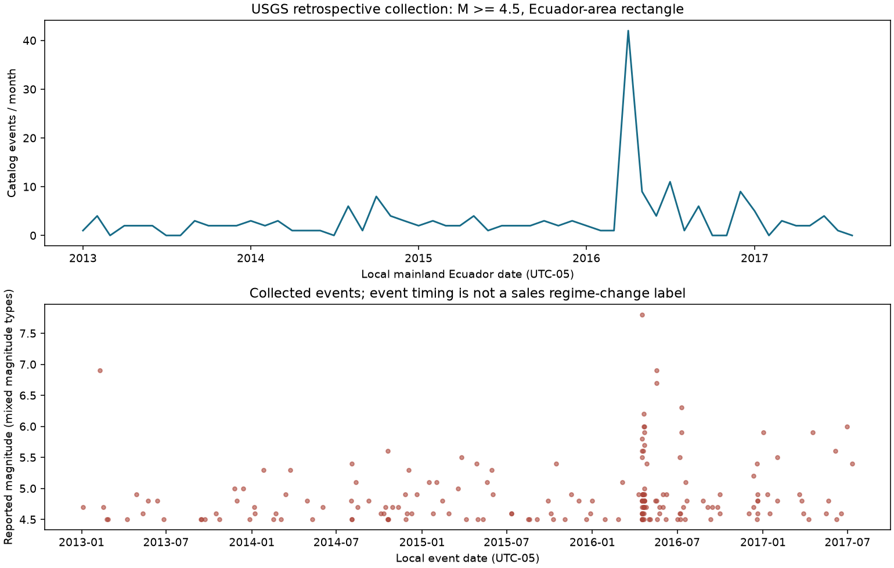

# Thu thập dữ liệu web bổ sung cho bài toán Favorita

## Vai trò trong bài tập lớn

Dự án tự viết chương trình thu thập qua HTTP API công khai của USGS, lưu GeoJSON gốc, chuẩn hóa schema/thời gian, kiểm tra dữ liệu và ghép với doanh số. Đây là **thu thập web qua API**, không phải cào DOM HTML. Nhãn doanh số vẫn đến từ dataset Favorita có sẵn; phần tự thu thập là dữ liệu động đất ngoại sinh. Không mô tả toàn bộ nhãn sales là dữ liệu do nhóm tự cào. Bộ dữ liệu mới chưa tham gia các model/số liệu Task 01–05 đã khóa.

## Nguồn và phạm vi đã thực hiện

- Nguồn: [USGS Earthquake Catalog API](https://earthquake.usgs.gov/fdsnws/event/1/); [schema GeoJSON](https://earthquake.usgs.gov/earthquakes/feed/v1.0/geojson.php).
- Cửa sổ nghiên cứu: 2013-01-01–2017-08-15; thu thêm 7 ngày trước đó để tính lag/rolling đầu kỳ.
- Hình chữ nhật: latitude [-5.1, 1.6], longitude [-81.2, -75.1], magnitude >= 4.5. Vùng này gồm Ecuador lục địa, vùng biển và một phần nước lân cận; không gán mọi event là nằm trong biên giới Ecuador. Không đại diện Galapagos hay mức rung tại từng cửa hàng.
- 6 truy vấn theo năm, timeout 45 giây, tối đa 3 lần khi lỗi mạng/429/5xx, nghỉ 1.0 giây giữa truy vấn. Cache kiểm tra checksum; chạy prepare/report không cần tải lại. Từ chối response lỗi schema/count hoặc chạm giới hạn 20.000 events để tránh cắt dữ liệu âm thầm.

| year | response_event_count | bytes | retrieved_at_utc | sha256 |
| --- | --- | --- | --- | --- |
| 2012 | 0 | 436 | 2026-10-14T15:09:56.913225+00:00 | a26d4e1676bd6ec0aa6093f5aaeda83c5748b213aaec027c905bfc4d48809ccc |
| 2013 | 20 | 14830 | 2026-10-14T15:11:12.664653+00:00 | b8d521b1d9ac9aba28590ca01a6740f5b7221040d3b558db62ea055eee693504 |
| 2014 | 33 | 24179 | 2026-10-14T15:11:28.639887+00:00 | ded2ecd5254e993de8fc31be2a8dc654f0907ec4ba8abfe56d7653d9c4959aab |
| 2015 | 28 | 20743 | 2026-10-14T15:11:35.613775+00:00 | ededff8ecfa162856c3f982c7928e58acb6487b1d9aaf29931e4bcdcd3e942f9 |
| 2016 | 86 | 64156 | 2026-10-14T15:11:44.419937+00:00 | 08024c6dcf242d2bf2bf8f87266cb41a67d01bfe3d44c72b1233c31ff14b766b |
| 2017 | 17 | 12979 | 2026-10-14T15:11:50.857963+00:00 | 265cb455ec738a96150f579bc0d6d13a8a27fa896419c23031d64a9ee4568992 |

Manifest lưu đầy đủ URL, HTTP status, thời điểm truy xuất UTC, dung lượng, SHA-256 và cấu hình. [Manifest](../data/raw/external/usgs_ecuador/2026-10-14/manifest.json).

## Kết quả tiền xử lý và kiểm tra

Thu được **184 events** kể cả lookback; **184 events** trong kỳ nghiên cứu; **134 ngày có ít nhất một event** trong 1688 ngày lịch. Có 0 ID lặp được loại theo revision mới nhất và 0 hàng ngoài cửa sổ được loại. Magnitude nghiên cứu từ 4.5 đến 7.8.

Thời gian gốc milliseconds UTC được chuyển về UTC-05:00 trước khi lấy ngày. Magnitude/coordinates/time/ID phải hợp lệ; `updated_at_utc` được giữ nguyên và **không coi là thời điểm công bố đầu tiên**. API hiện tại có thể không trả `metadata.count`; khi có trường này phải khớp số features, còn manifest luôn đếm số features thực nhận. Các magnitude types khác nhau được giữ trong bảng, chưa đồng nhất sang một thang duy nhất. Ngày không có event trong kết quả truy vấn nhận count=0; magnitude ngày đó để missing. Count=0 chỉ nói không có bản ghi thỏa truy vấn, không chứng minh không có động đất hoặc catalog đầy đủ vật lý.

[Events chuẩn hóa](../data/processed/external/usgs_ecuador/2026-10-14/events.csv); [calendar/feature theo ngày](../data/processed/external/usgs_ecuador/2026-10-14/daily_calendar.csv); [quality audit](../data/processed/external/usgs_ecuador/2026-10-14/quality_audit.json).

## Ghép dữ liệu và feature

Ghép many-to-one theo ngày nếu dùng từng dòng sales; bản minh họa cộng doanh số theo ngày rồi ghép one-to-one, phủ **3,000,888 nhãn doanh số qua 1684 ngày**. Có 4 ngày lịch không có bản ghi sales, giữ chúng là thiếu doanh số. [Bảng ghép theo ngày](../data/processed/external/usgs_ecuador/2026-10-14/daily_sales_external_join.csv). Không nhân bản hay thay đổi các nhãn gốc. SHA-256 train.csv trước/sau: `99a1b7f4241821df10fa71f23abdd71c634f71f901e3cab1400c0f0c583f862c`.

Đặt $C_t$ là số event theo local date, $S_t$ là số event magnitude >= 6.0, $M_t$ là magnitude lớn nhất ngày đó. Feature đề xuất:

$$x'_{g,t}=[x_{g,t}, C_{t-1}, S_{t-1}, M_{t-1}, \sum_{j=1}^7 C_{t-j}].$$

`MODEL_FEATURES = ['quake_count_lag1', 'strong_quake_count_lag1', 'quake_max_magnitude_lag1', 'quake_count_prev7d']`. Các cột event cùng ngày chỉ phục vụ EDA, không nằm trong danh sách feature mô hình. Chỉ mục này dùng thông tin sự kiện trước ngày dự báo, nhưng **availability lịch sử vẫn NOT VERIFIED**: catalog lấy hôm nay đã được revision, không có snapshot/bản tin đầu tiên tại từng ngày 2013–2017. Vì thế feature trễ hiện chỉ sẵn sàng cho ablation hồi cứu/exploratory; không đủ chứng minh pipeline vận hành as-of không leakage. Magnitude cùng ngày, thiệt hại tổng kết sau sự kiện và posterior jump không phải feature tiên tri.

## Phân tích mô tả

| year | events | event_days | max_magnitude | strong_events |
| --- | --- | --- | --- | --- |
| 2013 | 20 | 20 | 6.9000 | 1 |
| 2014 | 33 | 29 | 5.6000 | 0 |
| 2015 | 28 | 27 | 5.5000 | 0 |
| 2016 | 86 | 42 | 7.8000 | 7 |
| 2017 | 17 | 16 | 6.0000 | 1 |



Các event magnitude lớn nhất (mô tả nguồn, không chọn model hoặc định nghĩa jump ground truth):

| event_id | local_date | magnitude | magnitude_type | depth_km |
| --- | --- | --- | --- | --- |
| us20005j32 | 2016-04-16 00:00:00 | 7.8000 | mww | 20.5900 |
| usc000f4ij | 2013-02-09 00:00:00 | 6.9000 | mww | 145.0000 |
| us10005i9n | 2016-05-18 00:00:00 | 6.9000 | mww | 29.9500 |
| us10005i5t | 2016-05-18 00:00:00 | 6.7000 | mww | 16.0000 |
| us100062hg | 2016-07-10 00:00:00 | 6.3000 | mww | 21.0000 |
| us20005k37 | 2016-04-20 00:00:00 | 6.2000 | mww | 14.0000 |
| us20005kb6 | 2016-04-20 00:00:00 | 6.0000 | mwb | 10.0000 |
| us20005kqh | 2016-04-21 00:00:00 | 6.0000 | mww | 10.0000 |
| us100095nr | 2017-06-30 00:00:00 | 6.0000 | mww | 13.0000 |
| us20005kqp | 2016-04-21 00:00:00 | 5.9000 | mww | 10.2900 |

Liên hệ doanh số chỉ tính trên **train đến 2015-12-31**, chưa điều chỉnh weekday, mùa vụ, promotion hoặc aftershock clustering:

| previous_day_event | days | mean_daily_sales | mean_daily_log_sales | mean_zero_rate |
| --- | --- | --- | --- | --- |
| False | 1016 | 302.2178 | 2.6211 | 0.3911 |
| True | 76 | 321.9654 | 2.7037 | 0.3703 |

Bảng này là association thô, không kết luận động đất gây biến động sales. Dữ liệu mới không được dùng để chọn lại model theo test đã xem. Ablation tương lai cần so cùng model/seed/split với và không có các feature này; báo cáo cả RMSLE, MAE và mức coverage/availability của nguồn. Chưa có số liệu chứng minh tăng accuracy từ dữ liệu mới.

## Tái lập

```powershell
./.venv/Scripts/python.exe -m scripts.collect_external_data --stage collect --snapshot data/raw/external/usgs_ecuador/2026-10-14
./.venv/Scripts/python.exe -m scripts.collect_external_data --stage prepare --snapshot data/raw/external/usgs_ecuador/2026-10-14
./.venv/Scripts/python.exe -m scripts.collect_external_data --stage report --snapshot data/raw/external/usgs_ecuador/2026-10-14
```

Mục tiêu học phần được minh họa bằng chuỗi **thu thập web → raw snapshot → tiền xử lý/QA → ghép nguồn → EDA → thiết kế feature và ablation ML**. API collection và HTML scraping là hai cách khác nhau; cần mô tả đúng cách đã thực hiện. Không đảm bảo tiêu chí chấm khi chưa có rubric chính thức yêu cầu tự thu thập toàn bộ target.

<!-- usgs-model-link -->
## Train/test sau thu thập

[Thực nghiệm toàn bộ 1.782 chuỗi](USGS_MODEL_ABLATION.md) đã dùng feature USGS để train trên 1.945.944 dòng và test 892.782 dòng. Validation chọn USGS, nhưng test RMSLE tăng +0.001400; kết quả không xác nhận cải thiện accuracy. Pipeline thu thập–tiền xử lý–train–test đã thực hiện đầy đủ, với provenance và giới hạn availability được giữ rõ.
