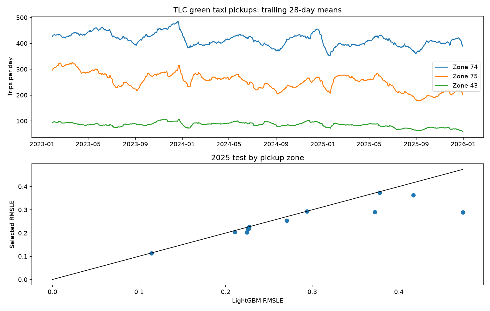

# Bộ dữ liệu chính: tự thu thập chuyến Green Taxi và dự báo nhu cầu theo khu vực

## 1. Bài toán có ý nghĩa vận hành

Với mỗi khu vực đón khách $g$ và ngày $t$, dự báo **số chuyến Green Taxi bắt đầu** tại khu vực đó trong ngày tiếp theo: $y_{g,t}$. Đầu ra có thể hỗ trợ phân bổ nguồn lực xe theo khu vực. Đây là **số chuyến thực hiện được**, không phải mọi yêu cầu đặt xe hoặc nhu cầu chưa được phục vụ.

Nguồn là [NYC Taxi & Limousine Commission — Trip Record Data](https://www.nyc.gov/site/tlc/about/tlc-trip-record-data.page), mục Green Taxi Trip Records. Cơ quan công bố tệp Parquet hằng tháng; tài liệu nêu các cột thời gian đón/trả và vị trí, đồng thời cảnh báo không bảo đảm hoàn toàn tính chính xác của dữ liệu nhà cung cấp gửi. **Nhóm viết crawler lấy link từ trang TLC, tự tải 36 tệp chính thức và chuyển hơn 2 triệu chuyến thành nhãn khu vực-ngày.**

## 2. Thu thập có provenance

`scripts/collect_tlc_green.py` fetch và parse HTML trang danh mục, lưu SHA-256 phản hồi và link đã crawl trong [crawl manifest](../provenance/tlc_green_crawl_manifest.json). Crawler tải tuần tự các tệp từ 2023-01 đến 2025-12 qua URL chính thức, lưu Parquet gốc trong `data/raw/tlc_green/2026-10-16/`, mỗi tệp có URL, bytes và SHA-256 trong [raw manifest](../provenance/tlc_green_manifest.json). Cache được kiểm hash, không tải lại hoặc âm thầm thay đổi snapshot. Snapshot hiện tại lấy 27 link từ HTML; 9 tháng cũ không còn xuất hiện trên trang được ghi rõ là fallback theo URL archive pattern. Dữ liệu thô không commit. Tổng **36 tháng, 2.038.653 bản ghi chuyến thô**; code chỉ đọc cột `lpep_pickup_datetime` và `PULocationID` để giảm RAM/CPU và tránh đưa thông tin sau thời điểm dự báo vào feature.

[Bảng định danh taxi zone chính thức](../provenance/tlc_taxi_zone_lookup.csv) được lấy từ cùng trang TLC để diễn giải kết quả; chỉ dùng khi báo cáo, không dùng chọn nhóm hay huấn luyện.

## 3. Tiền xử lý có quy tắc kiểm tra được

Từng tệp được kiểm SHA-256 trước khi đọc. Bản ghi được giữ nếu thời gian pickup nằm **đúng tháng của tệp** và `PULocationID` là số nguyên trong 1–263. Có 0 thời gian thiếu, 553 bản ghi ngoài tháng và 6.011 bản ghi có zone không hợp lệ (hai loại lỗi có thể giao nhau); **2.032.098** bản ghi được giữ. [Audit từng tháng](tables/tlc_green_monthly_quality.csv) và [audit tổng](tables/tlc_green_quality_audit.json) cho phép kiểm lại số lượng. Vì bản ghi nguồn không cung cấp ID chuyến duy nhất cho bài toán này, không tự ý gộp các hàng có thời gian/vị trí trùng nhau: chúng có thể là chuyến khác nhau.

Sau làm sạch, dữ liệu gốc được tích hợp thành cơ sở dữ liệu truy vấn được ở local. Crawler kiểm schema Parquet/footer trước khi nhận file mới; builder stream file, khóa từng chuyến vào tên file và số dòng nguồn, rồi đối chiếu hàng tháng và chạy SQLite integrity check. Chi tiết các bảng được mô tả trong [tài liệu pipeline](DATA_PIPELINE.md).

Từ riêng **năm train 2023**, chọn 12 zone có số pickup cao nhất, sau đó cố định tập này cho validation/test. Ví dụ: East Harlem North (74), East Harlem South (75), Central Harlem (41), Elmhurst (82), Astoria (7). Đây là lựa chọn theo train, không phải chọn zone có điểm test tốt. Gom số chuyến thành $y_{g,t}=\#\{\text{pickup hợp lệ ở }(g,t)\}$; dựng lưới 1.096 ngày × 12 zone = **13.152 nhãn**. Có đúng 1 zone-ngày bằng 0: vì đủ cả 36 tệp và đã kiểm dữ liệu tháng, 0 nghĩa là không có chuyến hợp lệ trong nguồn tháng ấy; không nhầm thiếu tệp với 0.

Số pickup cộng trên 12 zone giảm từ **553.564 (2023)** xuống **481.227 (2024)** và **423.062 (2025)**. Đây là thay đổi trong số chuyến được ghi nhận; không kết luận nguyên nhân hoặc nhu cầu tiềm ẩn.



## 4. Đặc trưng và giao thức chống leakage

Trước ngày $t$, mô hình chỉ thấy ID zone, lịch và lag $y_{g,t-k}$ với $k=1,7,28$, cùng trung bình trượt 7/28 ngày đã dịch một ngày:

$$m^{(w)}_{g,t}=\frac{1}{|O_{g,t}|}\sum_{k\in O_{g,t}}y_{g,t-k},\quad O_{g,t}\subseteq\{1,\ldots,w\},\quad w\in\{7,28\}.$$

Chỉ tính trung bình khi có ít nhất 3 ngày quá khứ cho cửa sổ 7 hoặc 7 ngày cho cửa sổ 28; sớm hơn thì giữ missing cho LightGBM. Không dùng doanh thu, giá cước, thời gian trả, tổng chuyến cùng ngày hoặc nhãn của zone khác trong ngày. Kiểm thử phản thực tế xác nhận sửa $y_{g,t}$ không đổi đặc trưng/dự báo trước cập nhật của ngày $t$.

| Khoảng | Vai trò | Số zone-ngày |
|---|---|---:|
| 2023 | Huấn luyện LightGBM | 4.380 |
| 01–06/2024 | Chọn tham số Kalman | 2.184 |
| 07–12/2024 | Quan sát tiếp diễn, không chọn | 2.208 |
| 2025 | Test khóa | 4.380 |

LightGBM cố định: 300 cây, learning rate 0,04, tối đa 31 lá, tối thiểu 30 quan sát/lá, seed 42, 4 luồng CPU; target $z=\log(1+y)$. Không train lại cây trên validation/test. Mỗi ngày được dự báo trước khi nhãn ngày ấy cập nhật bộ lọc. `selection_lock.json` local lưu tham số chọn và hash dữ liệu/mã/mô hình trước khi chạy test.

## 5. Mô hình thích nghi và chứng minh mức cần thiết

Đặt $r_{g,t}=z_{g,t}-f(x_{g,t})$. Bộ lọc cho mỗi zone có trạng thái sai lệch:

$$b_{g,t}=\rho b_{g,t-1}+\eta_{g,t},\quad\eta\sim N(0,q),\qquad r_{g,t}=b_{g,t}+\epsilon_{g,t},\quad\epsilon\sim N(0,R).$$

Trước khi nhận nhãn $t$, tính $m^-_{g,t}=\rho m_{g,t-1}$, $P^-_{g,t}=\rho^2P_{g,t-1}+q$, rồi công bố $\hat z_{g,t}=\max(0,f(x_{g,t})+m^-_{g,t})$. Sau khi có nhãn mới tính

$$K_{g,t}=\frac{P^-_{g,t}}{P^-_{g,t}+R},\quad m_{g,t}=m^-_{g,t}+K_{g,t}(r_{g,t}-m^-_{g,t}),\quad P_{g,t}=(1-K_{g,t})P^-_{g,t}.$$

Nếu mô hình Gaussian đúng, prior mean $m^-_{g,t}=E[b_{g,t}\mid r_{g,<t}]$ tối thiểu hóa kỳ vọng lỗi bình phương log có điều kiện. Với $q\ge0,R>0$, $0\le K<1$, $P\ge0$. Đây là bảo đảm về **ước lượng trong mô hình**, không phải định lý nói sẽ thắng LightGBM trên mọi tập thật. Selection H1/2024 chọn $\rho=1$, $q=0{,}0001$, $R=0{,}1$. $\rho=1$ cho phép mức lệch tồn tại lâu, còn $q$ nhỏ và $R$ lớn làm cập nhật mượt; phù hợp với giả thuyết sai lệch nền từ xu hướng số chuyến giảm. Đây là cách giải thích giả thuyết, không phải bằng chứng nhân quả cho xu hướng.

Đẳng thức không phụ thuộc Gaussian để kiểm chứng trên dữ liệu: nếu $e=z-\hat z_{base}$ và $d=\hat z_{adapt}-\hat z_{base}$, thì

$$\Delta\mathrm{MSE}_{log}=\overline{d^2}-2\overline{ed}.$$

Trên test, năng lượng sửa $\overline{d^2}=0{,}021195$, mức khớp hướng lỗi $2\overline{ed}=0{,}043522$, nên $\Delta\mathrm{MSE}_{log}=-0{,}022327$. Dự báo nền có sai lệch log trung bình −0,1212; phần sửa trung bình −0,1011, để lại sai lệch trung bình −0,0202.

## 6. Kết quả và độ tin cậy

| Giai đoạn | LightGBM RMSLE | LightGBM + Kalman RMSLE |
|---|---:|---:|
| Chọn H1/2024 | 0,251619 | **0,241664** |
| Tiếp diễn H2/2024 | 0,281401 | **0,272330** |
| Test khóa 2025 | 0,302883 | **0,263461** |

Trên test, seasonal naive cùng thứ tuần trước RMSLE **0,321347**, MAE **15,577** chuyến/zone-ngày. MAE LightGBM **14,274**, Kalman **13,320**. Kalman giảm RMSLE **0,039422**, tương đương khoảng **13,0%** so với LightGBM. Bootstrap ghép cặp theo 14 khối 28 ngày, 2.000 lần rút mẫu, cho khoảng 95% chênh RMSLE **[−0,046722; −0,030726]**; **14/14 khối** và [12/12 zone](tables/tlc_green_zone_test_metrics.csv) giảm lỗi RMSLE. Khoảng bootstrap là độ bất định theo khối thời gian trên tập test đã quan sát, không chứng minh tác động nhân quả hoặc bảo đảm cho đô thị khác.

Sau lượt này, [xác nhận tiếp trên 01–08/2026](TLC_2026_CONFIRMATION.md) đã giữ nguyên mô hình và tham số. Kết quả mới cho thấy Kalman tiếp tục giảm RMSLE so với LightGBM, nhưng lỗi tuyệt đối cao hơn 2025 và MAE không hơn baseline lag 7; vì vậy nên đọc cả hai giai đoạn khi đánh giá độ bền.

## 7. Giới hạn cần nói rõ trước giảng viên

TLC công bố dữ liệu hằng tháng, thường trễ khoảng hai tháng. Vì vậy backtest one-step theo ngày là **kịch bản nếu đơn vị vận hành có log chuyến mỗi ngày**, chưa phải dịch vụ công khai có thể dùng đúng ngày $t-1$ từ website TLC. Số chuyến hoàn thành còn chịu ảnh hưởng số xe, chính sách, phạm vi phục vụ và chất lượng ghi nhận; mô hình không ước lượng nhu cầu bị từ chối. Năm test 2025 cùng chiều giảm tổng chuyến, nên cần thêm các năm/đô thị khác để kiểm tra khả năng chịu đảo chiều xu hướng. Không dùng test để chọn zone, cây, tham số lọc hoặc trọng số.

## Chạy lại

```powershell
.\.venv\Scripts\python.exe -m pip install pyarrow
.\.venv\Scripts\python.exe -m scripts.collect_tlc_green --stage all
.\.venv\Scripts\python.exe -m scripts.run_tlc_green_forecast --stage develop
.\.venv\Scripts\python.exe -m scripts.run_tlc_green_forecast --stage test
.\.venv\Scripts\python.exe -m scripts.report_tlc_green
.\.venv\Scripts\python.exe -m unittest discover -s tests -q
```

Các stage develop/test từ chối ghi đè khóa và kết quả đã có. Dùng snapshot/output riêng khi tái lập lượt mới; giữ nguyên artifacts local của lượt này.
