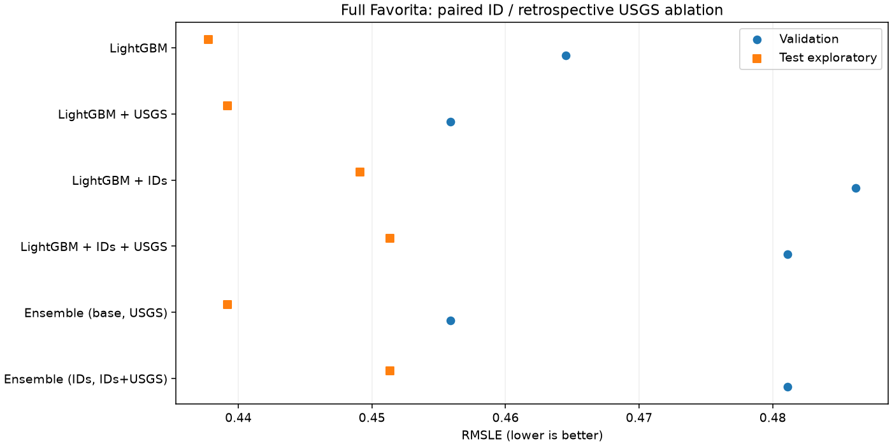

# Train/test toàn bộ Favorita với dữ liệu USGS tự thu thập

Lượt này dùng toàn bộ **1.782 chuỗi / 3.000.888 nhãn sales**, bốn LightGBM theo thiết kế 2×2 và hai ensemble. Đây là **hồi cứu/exploratory** vì giai đoạn test đã được xem và USGS là danh mục có revision, chưa xác minh thời điểm công bố lịch sử. [Nguồn và bước thu thập](DATA_COLLECTION.md). Kiểm toán mã thực nghiệm: `historical_snapshot`; report-only có thể dùng bản mã gốc đúng checksum trong `provenance/`, còn predict/test bắt buộc code hiện hành khớp khóa.

## Tiền xử lý và split

Giữ nguyên feature sales/lịch/promotion của pipeline cũ. Chỉ ghép allowlist gồm `['quake_count_lag1', 'strong_quake_count_lag1', 'quake_max_magnitude_lag1', 'quake_count_prev7d']`, many-to-one theo ngày, kiểm tra phủ đầy đủ và không tăng số nhãn. Lag sales theo đúng ngày lịch; rolling chỉ dùng quá khứ. Động đất chuyển UTC về UTC-05 Ecuador lục địa trước khi lấy ngày. Count=0 là không có bản ghi thỏa truy vấn, magnitude ngày không có event để NaN; LightGBM xử lý NaN. Chỉ thêm store_nbr/family dạng categorical ở hai nhánh IDs; không target encoding hay fit scaler trên test. Không dùng cột doanh số tổng hợp của bảng EDA hoặc event cùng ngày làm feature.

$$x'_{g,t}=[x_{g,t},C_{t-1},S_{t-1},M_{t-1},sum_{j=1}^7 C_{t-j}].$$

Train 2013-01-01–2015-12-31: **1.945.944** dòng; validation 2016-01-01–03-31: **162.162**; test 2016-04-01–2017-08-15: **892.782**. Tất cả chuỗi dùng chung một LightGBM mỗi variant. Actual-lag feedback trong test chỉ dùng nhãn trước ngày dự báo. Promotion cùng ngày vẫn cần giả định đã lên kế hoạch. Feature USGS có nhân quả theo **origin time**, nhưng không khẳng định as-of availability của revision.

## Train và khóa validation

Seed 42, 4 CPU threads; objective squared error trên log1p(sales); tối đa 500 cây, learning rate 0.05, tối đa 63 lá/cây; early stopping 50 vòng, chung ngân sách cho mọi variant. Validation dùng chung cho early stopping và chọn ensemble nên chưa là đánh giá độc lập. Không có lần retrain sau khi xem test.

| model | features | best_iteration | fit_seconds |
| --- | --- | --- | --- |
| LightGBM | 12 | 110 | 10.69 |
| LightGBM + USGS | 16 | 104 | 10.27 |
| LightGBM + IDs | 14 | 72 | 7.78 |
| LightGBM + IDs + USGS | 18 | 73 | 8.08 |

Hai ensemble trộn dự báo đã chặn không âm trên thang log:

$$hat z=(1-eta)hat z_A+etahat z_B,qquad
eta^star=operatorname{clip}_{[0,1]}rac{sum_{val}(z-hat z_A)(hat z_B-hat z_A)}{sum_{val}(hat z_B-hat z_A)^2}.$$

| model | left | right | beta |
| --- | --- | --- | --- |
| Ensemble (base, USGS) | LightGBM | LightGBM + USGS | 1.000000 |
| Ensemble (IDs, IDs+USGS) | LightGBM + IDs | LightGBM + IDs + USGS | 1.000000 |

Validation chọn **LightGBM + USGS** theo RMSLE, tie break theo thứ tự candidate cố định. Khóa UTC `2026-10-14T15:26:11.427656+00:00` được ghi trước test, gồm hash code/config/input/model và trọng số ensemble. Test có marker chống lặp; report stage chỉ tính lại từ predictions đã lưu. Thời gian validation tổng 53.3 giây; test preprocessing/predict/save 55.9 giây.

## Kết quả

| model | rmsle_validation | n | rmsle_test | mae | mean_series_rmsle |
| --- | --- | --- | --- | --- | --- |
| Seasonal naive | 0.869816 | 892782 | 0.653260 | 96.339911 | 0.614222 |
| LightGBM | 0.464533 | 892782 | 0.437766 | 77.815815 | 0.400143 |
| LightGBM + USGS | 0.455867 | 892782 | 0.439166 | 78.079079 | 0.402063 |
| LightGBM + IDs | 0.486228 | 892782 | 0.449127 | 98.223261 | 0.409885 |
| LightGBM + IDs + USGS | 0.481116 | 892782 | 0.451337 | 96.930139 | 0.410193 |
| Ensemble (base, USGS) | 0.455867 | 892782 | 0.439166 | 78.079079 | 0.402063 |
| Ensemble (IDs, IDs+USGS) | 0.481116 | 892782 | 0.451337 | 96.930139 | 0.410193 |



Tác dụng riêng của USGS trên test: ΔRMSLE **USGS − không USGS** = **+0.001400** khi chưa có IDs và **+0.002210** khi đã có IDs. Dấu âm là giảm sai số; dấu dương là tăng sai số. Dùng cặp có cùng IDs để tách ảnh hưởng dữ liệu thu thập khỏi ảnh hưởng nhận diện chuỗi. Metric trung bình theo chuỗi được báo cùng pooled RMSLE/MAE. Chỉ mô hình chọn trên validation được coi là quyết định của lượt này; không chọn lại theo thứ hạng test.

## Paired uncertainty

Bootstrap 500 lần, block 28 ngày, giữ tất cả chuỗi cùng block, seed 42; Δ = model − reference. Interval mô tả test cố định, không hiệu chỉnh multiple comparisons và không chứng minh tác động nhân quả của động đất.

| model | reference | delta_rmsle | ci_low | ci_high | blocks | block_days | repetitions | seed |
| --- | --- | --- | --- | --- | --- | --- | --- | --- |
| Seasonal naive | LightGBM | 0.2154935 | 0.1581453 | 0.2904245 | 18 | 28 | 500 | 42 |
| LightGBM + USGS | LightGBM | 0.0013998 | 0.0000646 | 0.0028807 | 18 | 28 | 500 | 42 |
| LightGBM + IDs | LightGBM | 0.0113607 | -0.0085145 | 0.0267018 | 18 | 28 | 500 | 42 |
| LightGBM + IDs + USGS | LightGBM | 0.0135710 | -0.0071838 | 0.0301525 | 18 | 28 | 500 | 42 |
| Ensemble (base, USGS) | LightGBM | 0.0013998 | 0.0000646 | 0.0028807 | 18 | 28 | 500 | 42 |
| Ensemble (IDs, IDs+USGS) | LightGBM | 0.0135710 | -0.0071838 | 0.0301525 | 18 | 28 | 500 | 42 |
| LightGBM + IDs + USGS | LightGBM + IDs | 0.0022103 | 0.0005645 | 0.0042412 | 18 | 28 | 500 | 42 |
| LightGBM + IDs + USGS | LightGBM + USGS | 0.0121712 | -0.0091071 | 0.0290329 | 18 | 28 | 500 | 42 |
| Ensemble (IDs, IDs+USGS) | LightGBM + IDs | 0.0022103 | 0.0005645 | 0.0042412 | 18 | 28 | 500 | 42 |
| Ensemble (base, USGS) | LightGBM + USGS | 0.0000000 | 0.0000000 | 0.0000000 | 18 | 28 | 500 | 42 |

## Artifact và provenance

Kết quả tại `../results/usgs_ablation_exploratory/`: selected_configs.json, preprocessing_audit.csv, validation_metrics.csv, validation_predictions.csv.gz, test_started.json, test_prediction_manifest.json, test_metrics.csv, test_predictions.csv.gz, paired_bootstrap.csv, comparison.csv, comparison.png và 4 LightGBM text models. Source/model/validation hashes đã kiểm tra lại; metric tính lại từ file dự báo. Kết quả các lượt cũ không bị ghi đè.

| input | SHA-256 |
| --- | --- |
| data/raw/train.csv | 99a1b7f4241821df10fa71f23abdd71c634f71f901e3cab1400c0f0c583f862c |
| configs/collection_usgs.json | 4bb34041ae5291fee51eb13c0fe47a90eb693e61cfe135fcc936745c4d6f3c4c |
| data/raw/external/usgs_ecuador/2026-10-14/manifest.json | 5edc3acb392798fe72140d335f6793ebf4895cdda4bee9e9d9b320fc18f6a558 |
| data/processed/external/usgs_ecuador/2026-10-14/quality_audit.json | 214e44a1c40c6ecc715ac3c3b1ccb4279b7b26ea69fcdb172f1daa7e6b4b1192 |
| data/processed/external/usgs_ecuador/2026-10-14/daily_calendar.csv | 5910c07727978659b3855378f77b8ed934cbfa57488a2a66278c5a490157893a |
| data/raw/external/usgs_ecuador/2026-10-14/events_2012.geojson | a26d4e1676bd6ec0aa6093f5aaeda83c5748b213aaec027c905bfc4d48809ccc |
| data/raw/external/usgs_ecuador/2026-10-14/events_2012.metadata.json | 8c1deef458bb0e3cb63336d972047ef2a34a829cba10cd3a1e221ccb71bc18c6 |
| data/raw/external/usgs_ecuador/2026-10-14/events_2013.geojson | b8d521b1d9ac9aba28590ca01a6740f5b7221040d3b558db62ea055eee693504 |
| data/raw/external/usgs_ecuador/2026-10-14/events_2013.metadata.json | 94e1a4f549c92752672924336bbe59c2e1ef445d48c776d80b0405bca37dc35e |
| data/raw/external/usgs_ecuador/2026-10-14/events_2014.geojson | ded2ecd5254e993de8fc31be2a8dc654f0907ec4ba8abfe56d7653d9c4959aab |
| data/raw/external/usgs_ecuador/2026-10-14/events_2014.metadata.json | 8ae3f855a70aa62f5098ee275928e5ffe97d58c054b4ba1011d2706de36395ed |
| data/raw/external/usgs_ecuador/2026-10-14/events_2015.geojson | ededff8ecfa162856c3f982c7928e58acb6487b1d9aaf29931e4bcdcd3e942f9 |
| data/raw/external/usgs_ecuador/2026-10-14/events_2015.metadata.json | 14ce8ef68fdf40d4d0ea1a55a5a8ef7128d4ce30fa6b873d7fa21b5c692a8a7d |
| data/raw/external/usgs_ecuador/2026-10-14/events_2016.geojson | 08024c6dcf242d2bf2bf8f87266cb41a67d01bfe3d44c72b1233c31ff14b766b |
| data/raw/external/usgs_ecuador/2026-10-14/events_2016.metadata.json | 3bc91d5b12b81fe978d91bbac622e503f77347498bcfe844f2e0a0237605ac54 |
| data/raw/external/usgs_ecuador/2026-10-14/events_2017.geojson | 265cb455ec738a96150f579bc0d6d13a8a27fa896419c23031d64a9ee4568992 |
| data/raw/external/usgs_ecuador/2026-10-14/events_2017.metadata.json | 3ff5243286bc74ce57d71108cb7239ab66f875cd420fe87b3bd85b413e97fafd |

## Tái lập

```powershell
./.venv/Scripts/python.exe -m scripts.run_usgs_ablation --stage validate
./.venv/Scripts/python.exe -m scripts.run_usgs_ablation --stage test
./.venv/Scripts/python.exe -m scripts.run_usgs_ablation --stage report
```

Hai lệnh đầu từ chối lặp khi đã khóa/đã bắt đầu test. Lệnh report chỉ đọc model và predictions đã khóa. Danh mục động đất vùng chữ nhật không phải ground-truth latent jump của sales, không mô tả mức rung tại từng cửa hàng. Một lượt seed và test đã xem không đủ xác nhận hiệu quả tổng quát hay triển khai realtime.

<!-- usgs-findings-start -->
## Nhận xét sau đánh giá đã khóa

USGS giảm RMSLE validation từ 0.464533 xuống 0.455867, nhưng test tăng từ 0.437766 lên 0.439166. ΔRMSLE USGS − baseline = +0.001400 (thay đổi tương đối +0.320%), paired CI 95% [+0.0000646, +0.0028807]. Trong lượt này dữ liệu thu thập chưa chứng minh giúp tăng độ chính xác trên test. Khoảng CI là mô tả exploratory, chưa hiệu chỉnh multiple comparisons.

Thêm IDs cũng không cải thiện RMSLE trong ngân sách/model hiện tại. Hai ensemble đều chọn beta=1 trên validation nên trùng nhánh có USGS; không có lợi ích ensemble tăng thêm. Đây không phải bằng chứng IDs hoặc ensemble luôn vô ích: chỉ là kết quả với feature/split/ngân sách đã thử. Không đổi trọng số hoặc tune lại theo test.

Quyết định của lượt đã khóa vẫn là LightGBM + USGS theo validation; kết quả test cho thấy lợi ích đó không tổng quát sang giai đoạn sau. Chưa đủ cơ sở nâng USGS/IDs thành kiến trúc mặc định. Có thể trình bày BTL bằng pipeline thu thập–tiền xử lý–ML hoàn chỉnh và báo cáo thẳng kết quả âm. Nếu nghiên cứu tiếp, cần rolling-origin validation trong dữ liệu phát triển và đánh giá phiên bản mới riêng, không biến test đã xem thành bằng chứng blind.
